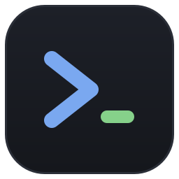

<p align="center">
  
</p>

<h1 align="center">Sharpie</h1>

<p align="center">
  A POSIX-style shell written in C#, with its own Avalonia terminal window.
</p>

<p align="center">
  <a href="LICENSE"></a>
  
  
</p>

<p align="center">
  <a href="#features">Features</a> ·
  <a href="#getting-started">Getting started</a> ·
  <a href="#using-the-window">Using the window</a> ·
  <a href="#shell-options">Shell options</a> ·
  <a href="#startup-file">Startup file</a> ·
  <a href="#net-docs-with-dman">dman</a> ·
  <a href="#not-supported-yet">Not supported yet</a> ·
  <a href="#development">Development</a>
</p>

---

Sharpie comes in two parts. `src/Sharpie` is the app, a terminal emulator window. It starts the shell engine,
`src/Sharpie.Shell`, in a pseudo-terminal (ConPTY on Windows) and draws its output on a character grid. Because of
that, the shell and every program it runs see a real terminal, and `[Y/n]` prompts, password prompts, `vim`, `htop`
and mouse reporting all work.

## Features

- **Real terminal.** Programs run in a pseudo-terminal, so colors, full-screen apps and mouse reporting work. The
  window adds scrollback and copy/paste.
- **Line editor.** The prompt header shows the folder, git branch and how long the last command took. Commands are
  colored as you type, <kbd>Tab</kbd> completes, <kbd>↑</kbd>/<kbd>↓</kbd> walk the history, and a gray suggestion from
  the history fills in as you type. <kbd>→</kbd> accepts it. <kbd>Ctrl</kbd>+<kbd>R</kbd> searches the history as in
  bash. bash's usual editing keys work too, among them <kbd>Ctrl</kbd>+<kbd>W</kbd>/<kbd>U</kbd>/<kbd>K</kbd> to cut and
  <kbd>Ctrl</kbd>+<kbd>Y</kbd> to paste back, <kbd>Alt</kbd>+<kbd>B</kbd>/<kbd>F</kbd>/<kbd>D</kbd>/<kbd>Backspace</kbd>
  for words, <kbd>Ctrl</kbd>+<kbd>T</kbd> to swap two characters, <kbd>Alt</kbd>+<kbd>.</kbd> for the last command's
  last word, <kbd>Ctrl</kbd>+<kbd>_</kbd> to undo, and <kbd>Ctrl</kbd>+<kbd>X</kbd> <kbd>Ctrl</kbd>+<kbd>E</kbd> to edit
  the line in `$VISUAL` or `$EDITOR` and run it. Setting `PS1` replaces the header and the `❯` with your own prompt,
  read as bash reads it: escapes like `\u`, `\w` and `\$`, `\[ \]` around colors, `$VAR` and `$(...)`.
  `PROMPT_COMMAND` runs before each prompt.
- **Tabs.** Each tab runs its own shell, and a new tab opens in the current tab's folder.
- **Job control.** POSIX job control with `&`, `jobs`, `fg`, `bg`, `wait`, `kill` and `disown`, plus pipelines and
  command lists joined by `;`, `&&` and `||`.
- **Control flow.** `if`/`elif`/`else`, `while`, `until`, `for`, `for ((i=0; i<3; i++))`, `case`, `(( ... ))`,
  `{ ...; }` groups, `( ... )` subshells, `!`, and `break`/`continue`, at the prompt, in `-c` strings and in scripts. A compound
  command can span lines, and the prompt asks for the rest with `> `. Redirects after one apply to everything inside,
  so `{ echo a; ls; } > f` and `while read l; do ...; done < f` work, and a compound stage of a pipeline runs in a
  copy of the shell with real pipes, so `tail -f log | while read l; do ...; done` streams.
- **Expansions.** `$NAME`, `~`, wildcards like `*.tmp`, and command substitution with `$(...)` or backquotes, so
  `cd $(git rev-parse --show-toplevel)` and `export GPG_TTY=$(tty)` work. A substitution runs in the shell itself, and
  the folder, variables and aliases it changes are put back afterwards, as a subshell would leave them. The special
  parameters work as in bash: `$1` to `$9`, `${10}`, `$#`, `"$@"`, `$*`, `$?`, `$$`, `$!`, `$-` and `$0`, along with
  `RANDOM`, `SECONDS`, `LINENO`, `SHLVL` and `PPID`. Inside braces, `${X:-default}`, `${X:=default}`, `${X:?message}`,
  `${X:+other}` (each also without the colon), `${#X}`, `${X#pattern}`, `${X##pattern}`, `${X%pattern}`,
  `${X%%pattern}`, `${X/pattern/text}`, `${X//pattern/text}`, `${X/#pattern/text}`, `${X/%pattern/text}` (an `&` in
  the text stands for the match), `${X^}`, `${X^^}`, `${X,}`, `${X,,}`, `${!X}`, `${X:offset:length}` and
  `${@:offset:length}` work as in bash.
  `$((...))` works out bash's 64-bit integer arithmetic, so `n=$((n + 1))` counts, and an offset or length and the
  number tests of `[[ ]]` are expressions too. Brace expansion comes first, as in bash: `cp file{,.bak}`,
  `mkdir -p src/{a,b,c}`, `{1..10}`, `{01..10..2}` and `{a..e}` give one word each, in order.
- **Redirects.** Bash's redirects work on builtins, programs and every stage of a pipeline: `<`, `>`, `>>`, `>|`,
  `&>`, `&>>`, any stream number as in `3> f`, copies and closes like `2>&1` and `2>&-`, here-documents
  (`<<EOF` and `<<-EOF`) and here-strings (`<<< text`). `ls /nope 2>&1 | wc -l` counts the error line, and
  `/dev/null` works on Windows too. A here-document's lines expand `$NAME` and `$(...)` unless the delimiter is
  quoted, as in `<<'EOF'`. `set -C`, or starting with `Sharpie -C`, keeps `>` from replacing a file, and `>|`
  replaces it anyway.
- **Conditions.** `test` and `[` are builtins, so `[ -f file ]` works on Windows too, and `[[ ... ]]` works as in
  bash: `&&`, `||`, `!` and parentheses inside it, `==` and `!=` against a pattern as in `[[ $x == *.txt ]]`, `=~`
  against a regular expression, and no word splitting, so `[[ -n $x ]]` needs no quotes.
- **Functions.** `name() { ...; }` and `function name { ...; }` define a function, on one line or many. Its arguments
  are `$1`, `$#` and `"$@"` while it runs, `local` keeps a variable's change inside it, and `return` ends it or a
  sourced file. A function takes over a builtin of the same name, and `command name` still runs the builtin, so
  `cd() { command cd "$@" && ls; }` works. A redirect after the body, as in `f() { ...; } > log`, applies to every
  call, and a function in a pipeline runs in a copy of the shell like any compound stage.
- **Your existing setup.** The window copies the exported variables and aliases from your own `$SHELL`, so a `PATH`
  set in `~/.zshrc` works here too. After that it runs `~/.sharpierc`.
- **Built-in pagers.** `man` pages open in a reader inside the window, and `dman` shows .NET API docs and C# or VB
  keyword docs as man pages.
- **Encrypted history.** History is saved encrypted, with the key kept in the operating system's secret store.

**Builtins:** `:`, `alias`, `bg`, `break`, `cd`, `clear`, `command`, `complete`, `continue`, `declare`, `dirs`,
`disown`, `dman`, `echo`, `eval`, `exec`, `exit`, `export`, `false`, `fg`, `history`, `jobs`, `kill`, `local`, `popd`,
`pushd`, `pwd`, `read`, `return`, `set`, `shift`, `source` / `.`, `test` / `[`, `trap`, `true`, `type`, `ulimit`,
`umask`, `unalias`, `unset`, `wait`.

## Getting started

### Requirements

- [.NET 10 SDK](https://dotnet.microsoft.com/download)
- Linux, macOS or Windows
- Optional: [`fastfetch`](https://github.com/fastfetch-cli/fastfetch), which the window shows as a banner when a new
  shell starts if it's installed

> [!NOTE]
> On Linux the history key is stored in the Secret Service (GNOME Keyring or KWallet) through `secret-tool`. If no
> keyring is running, history still works but is only kept in memory for that session.

### Run from source

```sh
dotnet run --project src/Sharpie
```

### Install

Publish the window to a folder of your choice. The window is the `SharpieTerminal` executable. The shell,
`Sharpie`, is built and copied next to it.

```sh
dotnet publish src/Sharpie -c Release -o ~/.local/opt/Sharpie
```

To make Sharpie your login shell, add the full path of `Sharpie` to `/etc/shells` and run `chsh -s` with that path.
To make the window your desktop's default terminal, point the desktop at the `SharpieTerminal` executable. It accepts
xterm's `-e program args`, which is how KDE, GNOME and `xdg-terminal-exec` start terminal apps, and it opens in the
folder it was started from.

## Using the window

| Keys | Action |
| --- | --- |
| <kbd>Ctrl</kbd>+<kbd>Shift</kbd>+<kbd>T</kbd> | New tab, in the current tab's folder |
| <kbd>Ctrl</kbd>+<kbd>Shift</kbd>+<kbd>W</kbd> | Close the tab |
| <kbd>Ctrl</kbd>+<kbd>Tab</kbd> / <kbd>Ctrl</kbd>+<kbd>Shift</kbd>+<kbd>Tab</kbd> | Next / previous tab |
| <kbd>Alt</kbd>+<kbd>1</kbd> … <kbd>Alt</kbd>+<kbd>8</kbd> | Go to tab 1 to 8 |
| <kbd>Alt</kbd>+<kbd>9</kbd> | Go to the last tab |
| <kbd>Ctrl</kbd>+<kbd>Shift</kbd>+<kbd>C</kbd> | Copy the selection (plain <kbd>Ctrl</kbd>+<kbd>C</kbd> also copies while text is selected) |
| <kbd>Ctrl</kbd>+<kbd>V</kbd> | Paste |
| <kbd>Shift</kbd>+<kbd>PgUp</kbd> / <kbd>Shift</kbd>+<kbd>PgDn</kbd> | Scroll back / forward a page |

Plain <kbd>Ctrl</kbd>+<kbd>T</kbd> and <kbd>Ctrl</kbd>+<kbd>W</kbd> are left to the shell, which uses them to swap two
characters and delete a word. Hold <kbd>Shift</kbd> to select text with the mouse while a program like `vim` is using
it.

## Shell options

The shell, `Sharpie`, reads its arguments the way POSIX `sh` and bash do. Single-letter options can be combined, so
`-lc` is the same as `-l -c`.

| Option | Effect |
| --- | --- |
| `-c COMMAND [NAME [ARG...]]` | Run `COMMAND` and exit with its status. `NAME` sets `$0` and the `ARG`s are `$1` onwards |
| `FILE [ARG...]` | Run the commands in `FILE` and exit. The `ARG`s are `$1` onwards |
| `-i` | Interactive, even when not attached to a terminal |
| `-l`, `--login` | Login shell: load `/etc/profile` and `~/.profile` first. A leading `-` in the program name does the same |
| `--norc` | Skip `~/.sharpierc` |
| `-C` | Start with `set -C` on, so `>` won't replace an existing file |

```sh
Sharpie -c 'cd /tmp && pwd'
```

An unknown option prints an error and exits with status 2.

## Startup file

An interactive shell runs `~/.sharpierc` (`%USERPROFILE%\.sharpierc` on Windows) before its first prompt, the way
bash runs `~/.bashrc`. It holds ordinary command lines, run in order in the shell itself:

```sh
# ~/.sharpierc
export PAGER=less
export PATH="$PATH:$HOME/.dotnet/tools"
alias ls='ls -p --color=auto'
HISTFILE=$HOME/.sharpie_history
PS1='\[\e[32m\]\u@\h\[\e[0m\]:\w\$ '
. $HOME/.sharpie_aliases
```

A line ending in `\` continues on the next one, and a compound command or function runs on until its closing word,
like `fi`, `done` or `}`.
`Sharpie --norc` skips the file, and `. file` or `source file`
runs another one at any time.

### History

The window saves history to an encrypted file in a `sharpie` folder under your local application data folder. The
key is a random AES key kept in DPAPI on Windows, the login Keychain on macOS, and the Secret Service on Linux. If
`HISTFILE` is set, a plain-text copy of the history is also written there when the shell exits.

## .NET docs with `dman`

`dman` builds man pages from Microsoft's documentation. It takes a C# or VB keyword, a namespace, a type, a member or
a learn.microsoft.com address:

```sh
dman foreach
dman System.IO
dman String.Split
dman -vb Select
```

`-vb` shows Visual Basic keywords, signatures and examples instead of C#. `dman --download` saves every page for
offline use. Inside the window the page opens in the built-in reader, in another terminal it goes through
`less`, and when redirected or piped it's written as plain text.

## Not supported yet

> [!WARNING]
> Some of the POSIX shell language is still missing:
>
> - **`;&` and `;;&` in `case`, and `select`.** A `case` item has to end with `;;`.

## Development

```sh
dotnet test Sharpie.slnx
```

Each project is organized by feature. `Features/<Feature>/` holds everything for one feature, and `Common/` holds what
several features share. The test projects use the same folders.

<details>
<summary><strong>Benchmarks</strong></summary>

The [BenchmarkDotNet](https://benchmarkdotnet.org/) project times the busiest parts of the app: the terminal screen,
the terminal view, the line editor, highlighting, completion and the history file. Pick benchmarks with `--filter`,
or leave it off to choose from a menu:

```sh
dotnet run -c Release --project benchmarks/Sharpie.Benchmarks -- --filter '*VtScreen*'
```

</details>

<details>
<summary><strong>Mutation tests</strong></summary>

[Stryker.NET](https://stryker-mutator.io/docs/stryker-net/introduction/) is a local tool. Each test project has its
own `stryker-config.json`, so run it from the test project's folder:

```sh
dotnet tool restore
cd tests/Sharpie.Shell.Tests
dotnet stryker
```

</details>

## License

Copyright (C) 2026 Nathan Price

Sharpie is free software: you can redistribute it and/or modify it under the terms of the
GNU General Public License as published by the Free Software Foundation, either version 3
of the License, or (at your option) any later version. See [LICENSE](LICENSE).
